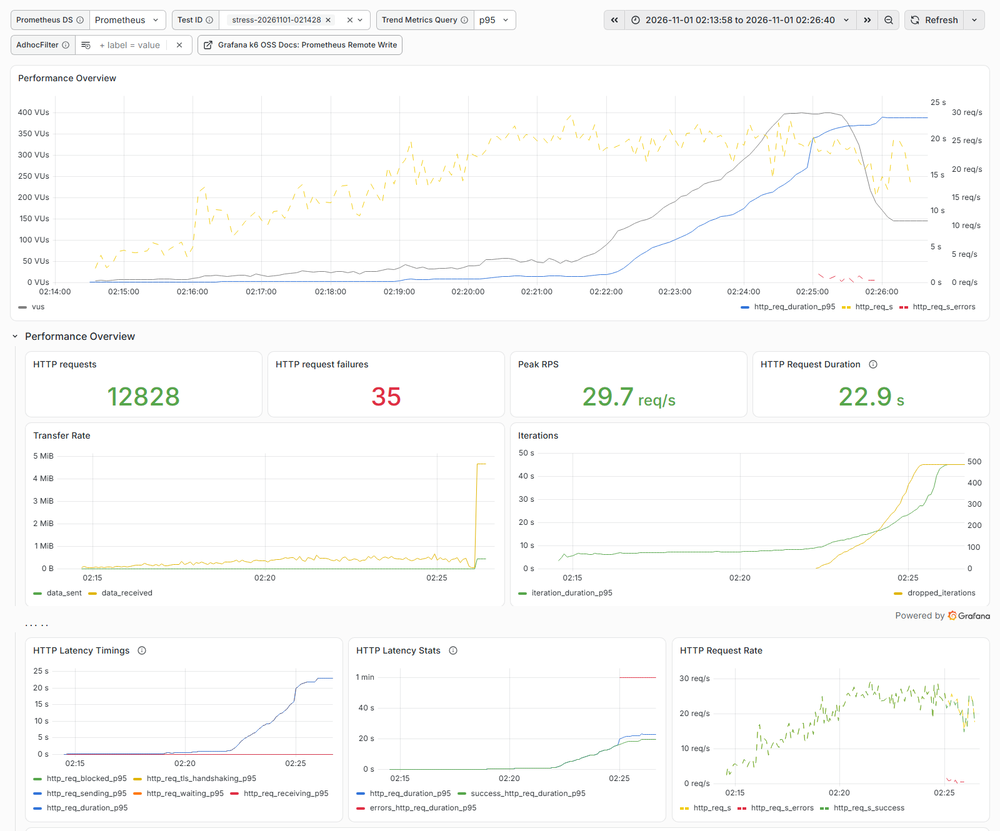
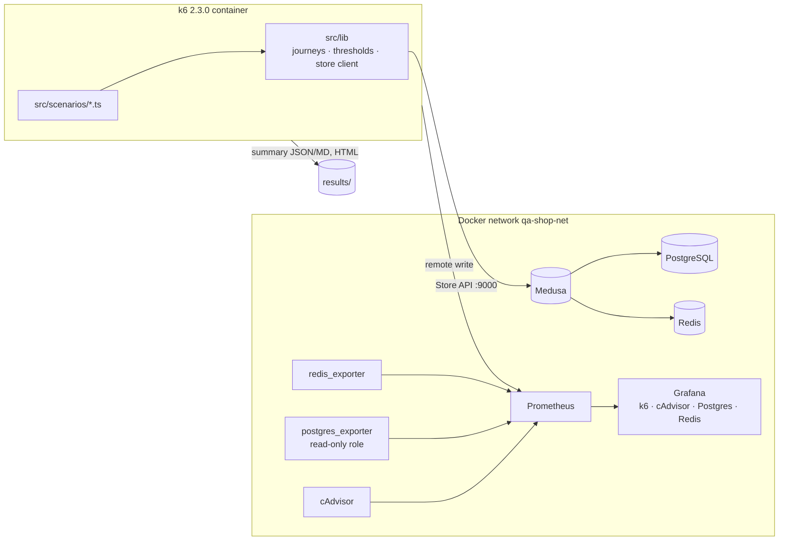

# Shop performance · k6 + Prometheus + Grafana

Performance tests for the **Medusa** Store API with an explicit workload model, SLO thresholds as a CI gate,
a monitoring stack that correlates latency with container resources, and a measured before/after experiment
that found and removed the first bottleneck.

     

## In 30 seconds

- **6 real runs** on 2026-11-01 (load 10 min, stress, spike, soak 30 min, plus the experiment), each on a
  freshly reset shop, with Grafana screenshots and exported metrics in the repository.
- **Capacity found:** one Medusa process saturates at **~10 shopper journeys/s (~25 req/s)**; checkout latency
  breaks its SLO at that point (p95 1.8 s > 1.5 s), while Postgres keeps at most 2 of 11 connections busy.
- **Experiment:** Node.js cluster mode with 4 processes → the same stress profile passes every SLO up to
  16 journeys/s (catalog p95 **92 ms instead of 8.2 s**), at the cost of 2× memory and 4× DB connections.
- **The gate works:** thresholds per endpoint group make k6 exit with 99; proven with a deliberately strict
  threshold and in the stress and spike runs.
- Found that k6's Prometheus trend gauges are cumulative, and built the per-interval analysis from k6's
  web-dashboard export instead.

## Live reports

**Nightly load run on GitHub Pages:** https://bilokintaras.github.io/shop-performance-k6/ — summary, environment
and the k6 web dashboard (published by [`nightly.yml`](.github/workflows/nightly.yml) once it has run).
Locally every run writes `results/<testid>-dashboard.html` (k6 web dashboard), a JSON and Markdown summary, and Grafana shows it
live at http://localhost:3300. The full analysis: [docs/performance-test-report.md](docs/performance-test-report.md).



## Architecture



k6 and the monitoring containers join the shop's Docker network; nothing uses host networking, so the same
commands run on Linux and Docker Desktop for macOS.

## Stack

| Tool | Why |
|---|---|
| k6 2.3.0 (Docker), TypeScript natively | Open-model executors, thresholds as exit code, code review-friendly scripts ([ADR-001](docs/adr/ADR-001-k6.md)) |
| Prometheus 3.15 with remote-write receiver | One store for load metrics and resource metrics on one time axis ([ADR-002](docs/adr/ADR-002-prometheus-remote-write.md)) |
| Grafana 13.3, provisioned | Official k6 dashboard plus cAdvisor, Postgres and Redis dashboards, no manual setup |
| cAdvisor, postgres_exporter, redis_exporter | Container CPU/memory, connections and locks, Redis operations |
| k6 web dashboard export | Per-period (10 s) percentiles for step and timeline analysis ([ADR-003](docs/adr/ADR-003-per-interval-latency.md)) |
| ESLint (typescript-eslint strict), Prettier, `tsc --noEmit` | Typed, linted scenarios with `@types/k6` |

## Quick start

Prerequisites: Docker with Compose v2, GNU Make, Node.js ≥ 22 (only for typecheck, lint and the helper
scripts). macOS: `brew install node`. The shop comes from the sibling repository [`shop-sut`](https://github.com/BilokinTaras/shop-sut).

```bash
git clone https://github.com/BilokinTaras/shop-sut.git ../shop-sut   # the shop lives in its own repository, next to this one
make -C ../shop-sut up          # the shop; writes ../shop-sut/.generated/sut.env
make monitoring-up              # Prometheus, Grafana on http://localhost:3300 (admin / qa-local-grafana)
npm ci && make check            # types, lint, format
make smoke                      # 1 VU, 30 s; exit 0 = all thresholds held
make load                       # 10 minutes at 5 journeys/s
```

Every run tags its metrics with a test ID (`testid` in Grafana's k6 dashboard) and writes
`results/<scenario>-<timestamp>.{json,md}` and `results/<testid>-dashboard.html`.
Stop with `make monitoring-down` and `make -C ../shop-sut down`.

## Project structure

| Path | Purpose |
|---|---|
| `src/lib/config.ts` | Base URL, publishable key, region and think time from the environment |
| `src/lib/store.ts` | Store API client; every request tagged with a route template `name` and a `group` |
| `src/lib/journeys.ts` | Browse, search, cart, checkout journeys, the 60/15/15/10 mix, custom metrics |
| `src/lib/thresholds.ts` | SLOs as thresholds per group; `THRESHOLD_SCALE` for noisy runners |
| `src/lib/summary.ts` | End-of-test summary as JSON and Markdown with the gate result |
| `src/scenarios/` | smoke, load, stress, spike, soak, breakpoint |
| `scripts/k6.sh` | Runs a scenario in the pinned k6 image on the shop's network |
| `scripts/export-metrics.mjs` | Prometheus → CSV/JSON for one run (CPU, memory, connections, locks, Redis ops) |
| `scripts/stress-steps.mjs`, `scripts/run-timeline.mjs` | Per-step and per-minute tables from the k6 dashboard export |
| `scripts/record-env.sh`, `scripts/grafana-screenshot.mjs` | Environment record; real Grafana screenshots via Playwright |
| `monitoring/` | Compose project `qa-observability`, Prometheus config, Grafana provisioning and dashboards |
| `docs/` | Workload model, performance report, ADRs, screenshots, raw data of the reported runs |

## Test strategy

The [workload model](docs/workload-model.md) states the assumptions: a 60/15/15/10 journey mix, 1–3 s think
time, an open arrival-rate model, and SLOs per endpoint group (catalog and search p95 < 500 ms, cart
< 800 ms, checkout steps < 1.5 s, errors < 1 %). Scenarios answer one question each: does the planned load
meet the SLOs (load), where do they break (stress, breakpoint), what does a burst do (spike), does anything
drift over time (soak). Every test ID, environment and data reset is recorded so a run can be compared with
the next one.

## Coverage

| Area | Requests (route templates) |
|---|---|
| Catalog | `GET /store/products` (paged), `GET /store/products?handle` |
| Search | `GET /store/products?q` |
| Cart | `POST /store/carts`, `POST /store/carts/{id}/line-items` |
| Checkout | `POST /store/carts/{id}` (address), `GET /store/shipping-options`, `POST …/shipping-methods`, `POST /store/payment-collections`, `POST …/payment-sessions`, `POST /store/carts/{id}/complete` |

Not covered: customer accounts, the Admin API and the Next.js storefront (server-side rendering is a
different workload — see Roadmap).

## CI/CD

| Workflow | When | What runs |
|---|---|---|
| [`pr.yml`](.github/workflows/pr.yml) | every PR and push to `main` | `tsc`, ESLint, Prettier; then a 30-second smoke against a shop started by the shared [`start-sut`](https://github.com/BilokinTaras/shop-sut/tree/main/.github/actions/start-sut) action — **the thresholds are the gate**: k6 exits 99 on a breached SLO and the job fails |
| [`nightly.yml`](.github/workflows/nightly.yml) | daily 03:41 UTC, manual | about four minutes at 5 journeys/s on a fresh shop, environment recorded, summary and k6 web dashboard published to Pages |

**Why CI numbers are not the analysis.** A shared GitHub runner runs the shop, its database and k6 on two
vCPUs next to other tenants, so its latency is noisy and lower than the laptop's capacity. CI therefore
doubles the latency limits (`THRESHOLD_SCALE=2`) and keeps the error-rate and check thresholds as they are:
it catches regressions — a change that makes the shop much slower or starts failing requests — while the
capacity, bottleneck and experiment work stays local, in [the performance report](docs/performance-test-report.md).
Third-party actions are pinned to commit SHAs; `actionlint` and `zizmor` report nothing.

## How-to

| Task | Command |
|---|---|
| Change the load | `sh scripts/k6.sh load -e TARGET_RATE=8 -e HOLD=5m` (knobs are listed in each scenario file) |
| Relax thresholds for a slow runner | `sh scripts/k6.sh load -e THRESHOLD_SCALE=2` |
| Run without Prometheus | `NO_PROMETHEUS=1 sh scripts/k6.sh smoke` |
| See a run in Grafana | Dashboard "k6 Prometheus", pick the run in **Test ID** |
| Export a run's resource metrics | `node scripts/export-metrics.mjs <testid> <from-unix> <to-unix>` |
| Per-step stress table | `node scripts/stress-steps.mjs results/<testid>-dashboard.html results/metrics-<testid>.csv` |
| Screenshot a dashboard | `node scripts/grafana-screenshot.mjs qa-k6 <from-ms> <to-ms> out.png "&var-testid=<testid>"` |
| Add a journey | Add a function in `src/lib/journeys.ts`, give it a share in `shopper()`, tag its requests with a group, add a threshold |
| Compare one vs several shop processes | `SHOP_MEDUSA_CLUSTER=4 make -C ../shop-sut reset`, run, then `make -C ../shop-sut reset` |

## Results and findings

Runs of 2026-11-01 on a Ryzen 5 7600 laptop, Docker Desktop VM with 12 CPUs / 15 GiB, no container limits,
fresh database before every run. Full tables, screenshots and analysis:
[docs/performance-test-report.md](docs/performance-test-report.md); raw data: [docs/data/2026-11-01/](docs/data/2026-11-01/).

| Run | Gate | req/s | Failed | Catalog p95 | Checkout step p95 |
|---|---|---:|---:|---:|---:|
| load, 5 it/s, 10 min | PASS | 11.3 | 0 % | 68 ms | 382 ms |
| stress, 2 → 16 it/s | FAIL | 18.3 | 0.27 % | 8.2 s | 39.1 s |
| spike, 5 → 50 it/s | FAIL | 20.2 | 6.67 % | 27.1 s | 60 s (timeouts) |
| soak, 4 it/s, 30 min | PASS | 9.7 | 0.01 % | 57 ms | 314 ms |
| stress, 4 processes | PASS | 21.0 | 0 % | 77 ms | 393 ms |
| load, 4 processes | PASS | 11.5 | 0 % | 48 ms | 248 ms |

| ID | Finding |
|---|---|
| PERF-1 | One Medusa process saturates at ~10 journeys/s; the event loop is the first bottleneck (database idle) |
| PERF-2 | No backpressure: a 1-minute ×10 spike causes timeouts for minutes afterwards |
| PERF-3 | Cart writes are the first requests to time out under overload |
| OBS-1 | k6 remote-write trend gauges are cumulative, so Grafana latency panels hide per-interval spikes |

## Decisions

- [ADR-001](docs/adr/ADR-001-k6.md) — k6 over JMeter, Gatling, Locust
- [ADR-002](docs/adr/ADR-002-prometheus-remote-write.md) — Prometheus remote write over InfluxDB or a cloud service
- [ADR-003](docs/adr/ADR-003-per-interval-latency.md) — per-interval latency from the k6 dashboard export

## How AI was used

The owner defined the goals and scope and approved the strategy and tools. An AI coding assistant
(Claude Code) wrote most of the scripts and documentation within that plan. Every number comes from the runs
listed above; the raw summaries, exports and screenshots are in the repository.

## Roadmap & known limitations

- The workflows pass `actionlint`, `zizmor` and Prettier locally but have not run on GitHub yet.
- The nightly page shows the latest run only; a trend across nights is not kept yet.
- Load generator and shop share one laptop; results compare changes on the same stand, not production capacity.
- The catalog has 7 products; a larger seeded catalog would change search and paging costs.
- Cluster mode was tested up to 16 journeys/s; its ceiling is still to be found.
- 30-minute soak only: Medusa memory grew from ~745 to ~800 MiB after warm-up — a multi-hour soak is needed
  to rule out a slow leak.
- Grafana latency panels are cumulative (OBS-1); switching k6 to native histograms is the planned fix.
- Verified on Windows 11 x86_64 with Docker Desktop; macOS arm64 and Linux runs pending.

## Licence and credits

MIT © 2026 Taras Bilokin — [LICENSE](LICENSE).
Built with k6 (AGPL-3.0, used as an unmodified container image), Prometheus (Apache-2.0), Grafana (AGPL-3.0,
container image), cAdvisor (Apache-2.0), postgres_exporter (Apache-2.0), redis_exporter (MIT).
Dashboards in `monitoring/grafana/dashboards/` are from grafana.com — k6 Prometheus (ID 19665), cAdvisor
exporter (14282), PostgreSQL Database (9628), Redis Dashboard (763) — with the data source pinned and
defaults changed; their authors keep their rights.

---

Part of a QA portfolio: [shop-sut](https://github.com/BilokinTaras/shop-sut) (the shop under test) · [shop-e2e-playwright](https://github.com/BilokinTaras/shop-e2e-playwright) (UI and API end-to-end) · [shop-api-pytest](https://github.com/BilokinTaras/shop-api-pytest) (API depth) · **shop-performance-k6** (performance) · [devsecops-quality-gates](https://github.com/BilokinTaras/devsecops-quality-gates) (security pipeline)
