# Performance test report — Medusa shop (local stand)

- Date of runs: 2026-11-01, 02:02–03:34 local time (UTC+2)
- Tool: k6 2.3.0 in Docker; metrics to Prometheus 3.15.1 (remote write); dashboards in Grafana 13.3.0
- Raw evidence: [`docs/data/2026-11-01/`](data/2026-11-01/) — k6 end-of-test summaries (JSON, Markdown),
  k6 web-dashboard exports (HTML, 10 s periods), Prometheus exports (5 s CSV + avg/max JSON), environment.

## 1. Summary

- At the planned load (5 journeys/s ≈ 11 requests/s) every SLO holds with a wide margin: catalog p95 68 ms,
  checkout-step p95 382 ms, 0 % errors over 10 minutes. A 30-minute soak at 4 journeys/s is just as stable.
- The shop **saturates at about 10 journeys/s (≈ 25 requests/s)**. The first SLO to break is checkout-step
  latency at 10 journeys/s (p95 1.8 s > 1.5 s); from 12 journeys/s throughput stops growing and latency grows
  without bound (catalog p95 8.2 s at 16 journeys/s).
- **First bottleneck: the single Medusa Node.js process.** Its CPU flattens at 1.3–1.4 cores while Postgres
  stays below 0.45 cores with at most 2 of 11 pool connections active, Redis at most 0.05 cores, and the load
  generator below 0.12 cores.
- **Experiment:** the same stress profile with Medusa in Node.js cluster mode (4 processes) passes every SLO up
  to the highest step, 16 journeys/s (catalog p95 92 ms, checkout-step p95 477 ms, 0 % errors) — capacity at
  least 1.6× higher; the ceiling was not reached. Cost: about 2× the memory (2.3 GiB instead of 1.1 GiB peak)
  and 4× the open Postgres connections (41 instead of 11).
- A ×10 spike (5 → 50 journeys/s for 1 minute) overloads the single process: cart-changing requests time out
  after 60 s (6.7 % of all requests) and the shop **does not recover within the 3 minutes** of normal load that
  follow, because the queue built during the spike keeps draining.

## 2. Environment

| Item | Value |
|---|---|
| Host | AMD Ryzen 5 7600 (6 cores / 12 threads), 31 GiB RAM, Windows 11 (build 10.0.26200), x86_64 |
| Docker | Docker Desktop 29.7.2, Linux VM with 12 CPUs and 15.2 GiB; **no CPU or memory limits** on containers |
| Shop | Medusa 2.22.2 production build (`medusa start`), Next.js storefront idle during the tests |
| Data stores | PostgreSQL 17.11, Redis 7.4.12 (event bus, cache, workflow engine, locking) |
| Data | Fresh database before **every** run (`make reset`): 7 products, 0 orders |
| Load generator | grafana/k6:2.3.0 container on the same machine and Docker network as the shop |
| Monitoring | Prometheus, Grafana, cAdvisor v0.60.6, postgres_exporter v0.20.1 (read-only role), redis_exporter v1.96.0 |

Recorded by `scripts/record-env.sh`: [baseline](data/2026-11-01/environment-baseline.md),
[cluster run](data/2026-11-01/environment-cluster4.md) (its order count is after the run).

**Limits of these numbers.** Load generator and shop share one machine; Docker Desktop runs a VM; the catalog
is tiny; no CDN, no TLS, no network latency. The numbers locate bottlenecks and compare changes on the same
stand; they do not predict production capacity.

## 3. Method

- Workload model, SLOs and scenario profiles: [workload-model.md](workload-model.md). Open model
  (arrival-rate executors), mix browse 60 / search 15 / cart 15 / checkout 10, think time 1–3 s.
- Runs, one after another, each on a freshly reset shop, with 60–90 s of idle time in between:

  | Run | Profile | Duration |
  |---|---|---|
  | load | ramp to 5 it/s in 1 m, hold 8.5 m, ramp down 30 s | 10 m |
  | stress | 2 → 16 it/s in steps of 2 (20 s ramp + 60 s hold each) | 11 m |
  | spike | 5 it/s 2 m → 50 it/s for 1 m → 5 it/s 3 m | 6.5 m |
  | soak | constant 4 it/s | 30 m |
  | stress, cluster 4 | as stress, `SHOP_MEDUSA_CLUSTER=4` | 11 m |
  | load, cluster 4 | as load, `SHOP_MEDUSA_CLUSTER=4` | 10 m |

- **Where each number comes from.**
  - Whole-run percentiles, request counts and errors: k6 end-of-test summary.
  - Per-step and per-minute latency: the k6 web-dashboard export, which keeps each 10 s period's own
    percentiles (`scripts/stress-steps.mjs`, `scripts/run-timeline.mjs`).
  - CPU, memory, Postgres connections and locks, Redis operations: Prometheus (`scripts/export-metrics.mjs`).
- **Caveat found during analysis.** The trend gauges that k6 sends through Prometheus remote write
  (`k6_http_req_duration_p95` and others) behave as percentiles over the run so far, not over the last interval:
  after the spike the catalog p95 gauge stayed at 27 s for three minutes while the per-period p95 in the
  dashboard export fell to 8 s. The Grafana latency panels therefore show a cumulative curve; per-window
  latency in this report comes from the dashboard export. Native histograms are on the roadmap.

## 4. Results per run

Whole-run figures from the k6 summaries. "Checkout step" = any of the 7 checkout requests; "journey" = the
custom `checkout_duration` metric (all checkout calls of one order, no think time).

| Run | Gate | Requests | req/s | Failed | Dropped iterations | All p50 / p90 / p95 / p99 ms | Catalog p95 / p99 ms | Checkout step p95 / p99 ms | Journey p95 ms | Orders |
|---|---|---:|---:|---:|---:|---|---|---|---:|---:|
| load | PASS | 6 811 | 11.3 | 0 % | 0 | 41 / 185 / 243 / 446 | 68 / 112 | 382 / 750 | 1 760 | 269 |
| stress | **FAIL** | 12 831 | 18.3 | 0.27 % | 486 | 837 / 11 735 / 21 306 / 40 583 | 8 183 / 8 315 | 39 087 / 59 997 | 132 870 | 430 |
| spike | **FAIL** | 8 291 | 20.2 | 6.67 % | 1 378 | 13 824 / 48 219 / 59 998 / 59 998 | 27 061 / 27 436 | 59 998 / 59 999 | 187 254 | 127 |
| soak 30 m | PASS | 17 483 | 9.7 | 0.01 % | 0 | 35 / 160 / 207 / 341 | 57 / 86 | 314 / 490 | 1 332 | 688 |
| stress, cluster 4 | PASS | 14 157 | 21.0 | 0 % | 0 | 42 / 189 / 250 / 446 | 77 / 126 | 393 / 612 | 1 601 | 555 |
| load, cluster 4 | PASS | 6 907 | 11.5 | 0 % | 0 | 33 / 150 / 186 / 262 | 48 / 70 | 248 / 310 | 893 | 284 |

Peak resource use (Prometheus, 5 s samples):

| Run | Medusa CPU cores | Medusa memory MiB | Postgres CPU cores | Postgres connections | Postgres locks | Redis ops/s | k6 CPU cores |
|---|---:|---:|---:|---:|---:|---:|---:|
| load | 1.00 | 796 | 0.29 | 11 | 29 | 1 610 | 0.03 |
| stress | 1.51 | 1 130 | 0.41 | 11 | 54 | 1 928 | 0.05 |
| spike | 1.65 | 1 587 | 0.44 | 11 | 39 | 2 216 | 0.12 |
| soak | 1.01 | 818 | 0.29 | 11 | 56 | 1 395 | 0.03 |
| stress, cluster 4 | 3.31 | 2 287 | 0.73 | 41 | 67 | 3 406 | 0.06 |
| load, cluster 4 | 1.49 | 1 985 | 0.33 | 30 | 37 | 1 595 | 0.03 |

Grafana screenshots of each run (k6 dashboard filtered by the run's test ID; latency panels are cumulative,
see the caveat above):

| Run | k6 | Resources |
|---|---|---|
| load | 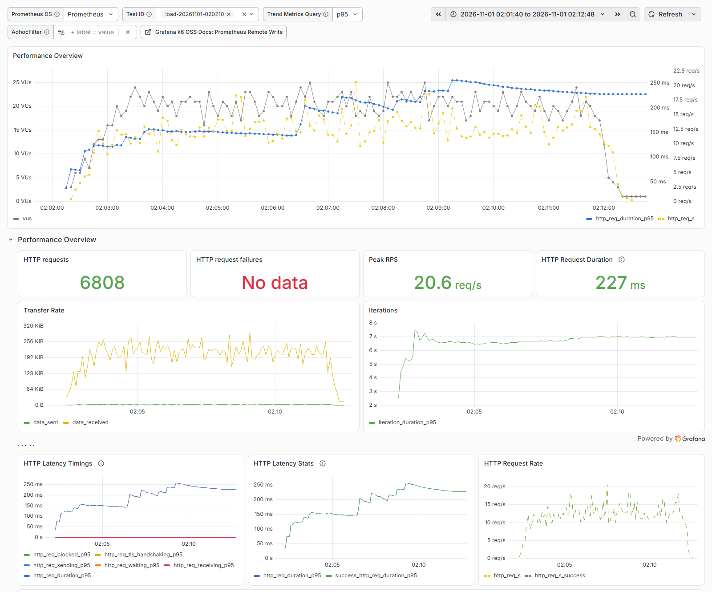 | — |
| stress | 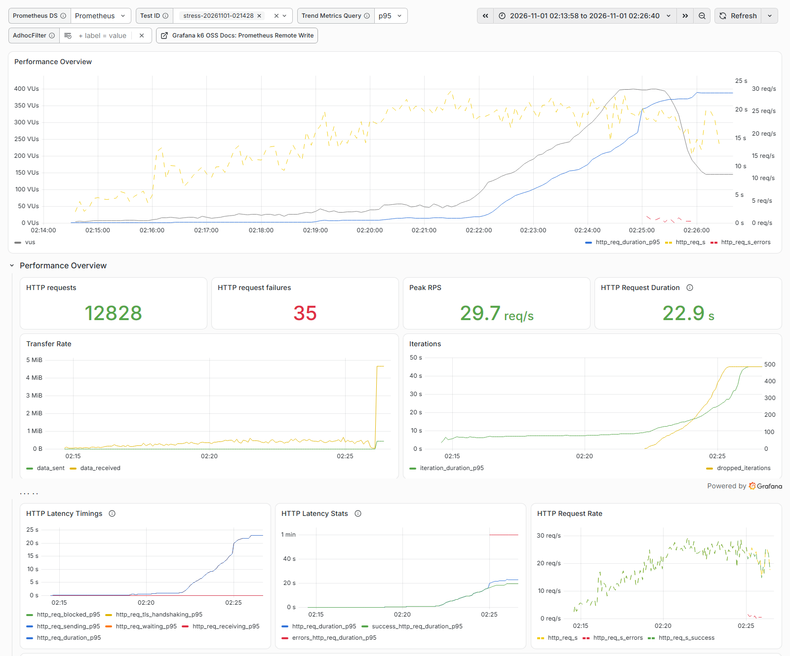 | 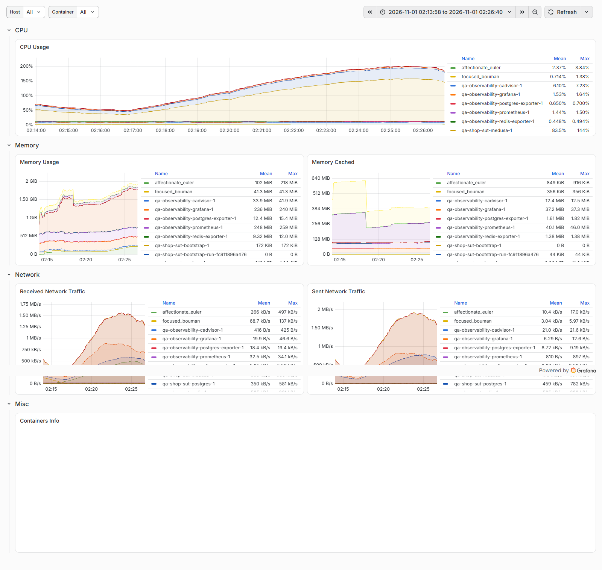 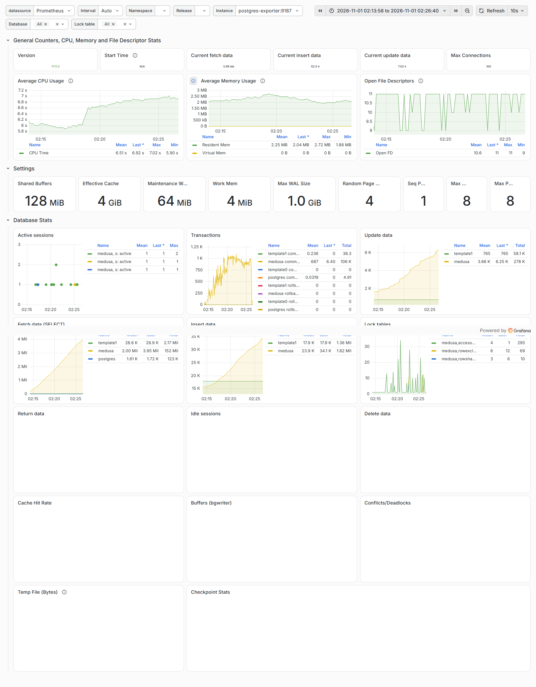 |
| spike | 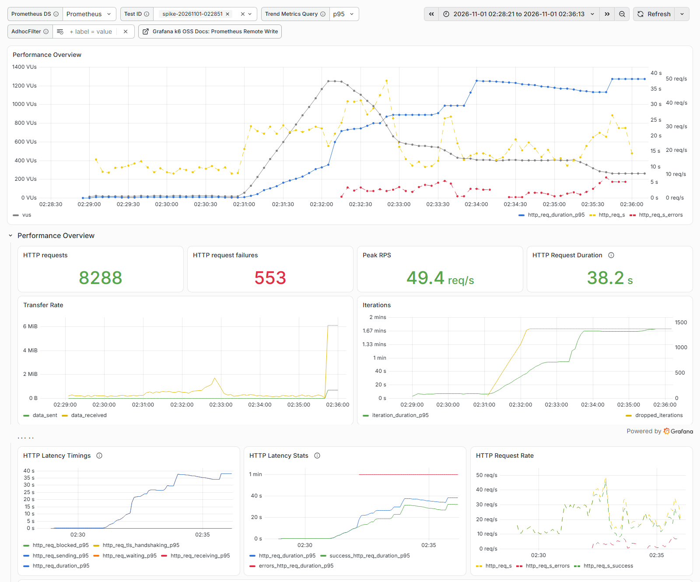 | — |
| soak | 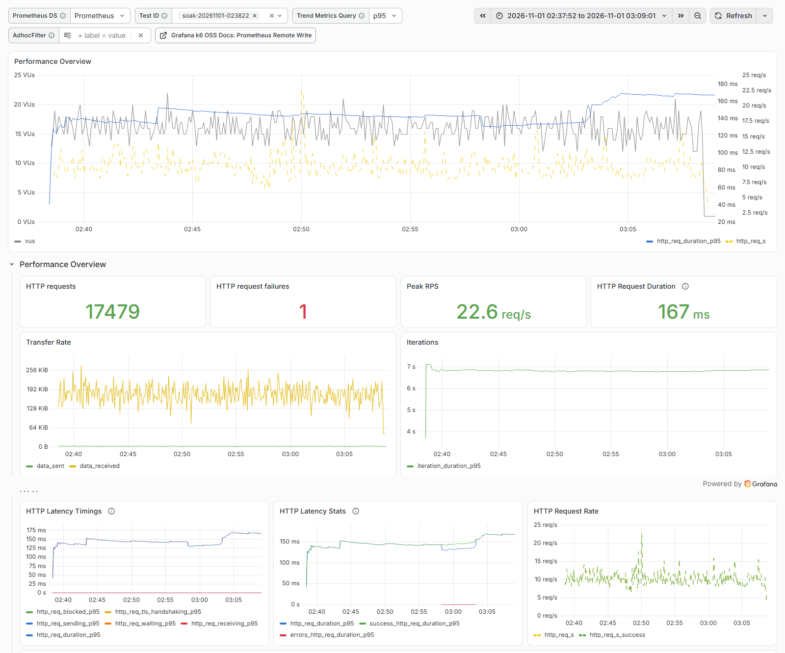 | 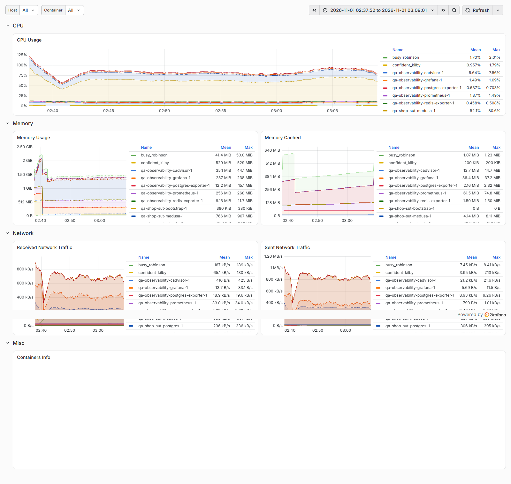 |
| stress, cluster 4 | 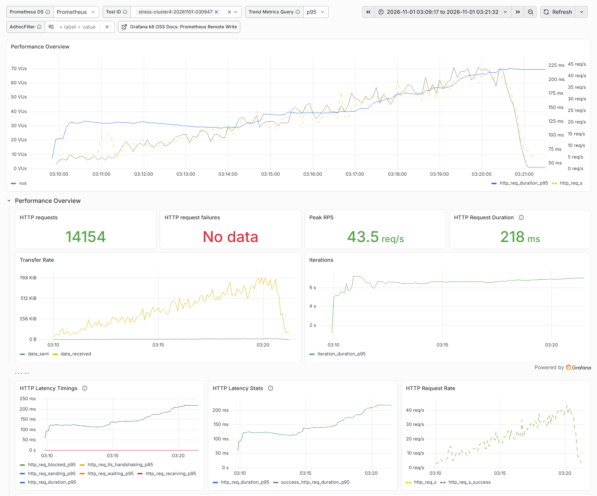 | 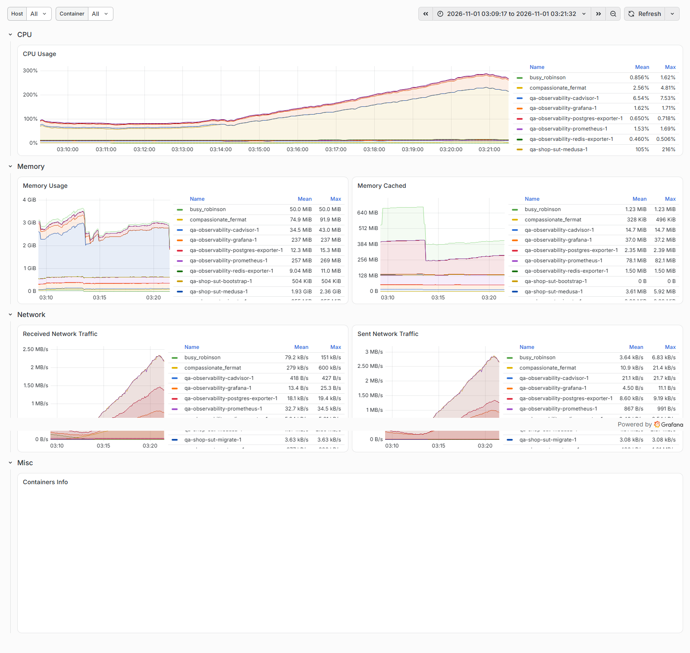 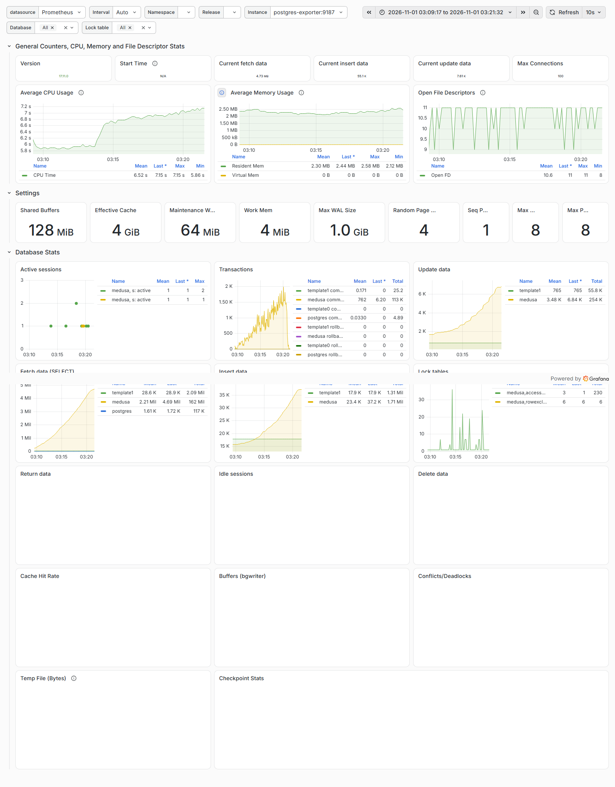 |
| load, cluster 4 | 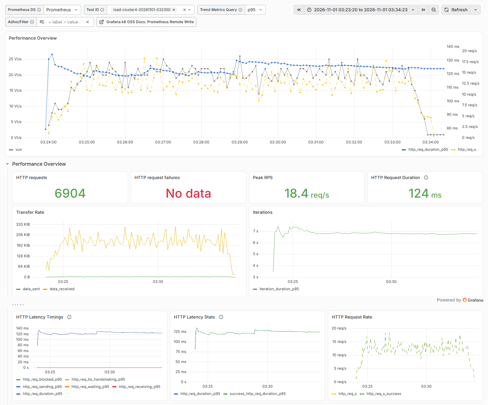 | — |

## 5. Analysis

### 5.1 Where the single process breaks (stress, per step)

Hold part of each step only; latency = median of the 10 s period p95 values in that window.

| Offered it/s | Achieved it/s | req/s | Dropped it/s | Failed % | Catalog p95 ms | Checkout step p95 ms | Medusa CPU cores | Postgres conns (max active) |
|---:|---:|---:|---:|---:|---:|---:|---:|---:|
| 2 | 2.0 | 5.6 | 0.0 | 0.00 | 44 | 199 | 0.36 | 8 (0) |
| 4 | 4.0 | 10.6 | 0.0 | 0.00 | 60 | 286 | 0.60 | 11 (2) |
| 6 | 6.0 | 14.5 | 0.0 | 0.00 | 66 | 320 | 0.81 | 11 (1) |
| 8 | 8.2 | 19.6 | 0.0 | 0.00 | 83 | 478 | 1.11 | 11 (2) |
| 10 | 9.8 | 25.5 | 0.0 | 0.00 | 362 | **1 785** | 1.20 | 11 (1) |
| 12 | 9.8 | 24.4 | 0.4 | 0.00 | **1 751** | 8 909 | 1.34 | 11 (1) |
| 14 | 11.1 | 25.0 | 1.5 | 0.00 | 4 136 | 29 708 | 1.37 | 11 (1) |
| 16 | 10.8 | 23.9 | 4.3 | 1.19 | 8 234 | 55 862 | 1.42 | 11 (1) |

Reading the table:

1. **Latency follows CPU, not the database.** Up to 8 it/s Medusa CPU grows linearly with load and latency
   is flat. At 10 it/s CPU reaches ~1.2 cores and checkout latency jumps 4×; from 12 it/s CPU flattens at
   1.3–1.4 cores, throughput stops at ~25 req/s and every extra request only lengthens the queue.
2. **The database is idle.** The pool keeps 11 connections open, but at most 2 are active in any 5 s sample,
   Postgres CPU stays ≤ 0.41 cores and lock counts stay small. A bigger pool would not help.
3. **Not Redis, not the load generator:** Redis ≤ 0.05 cores; k6 ≤ 0.05 cores.
4. 1.3–1.4 cores is what one Node.js process can use: one core for the JavaScript event loop plus helper
   threads (garbage collector, libuv). **Conclusion: the event loop of the single Medusa process is the first
   bottleneck.**

Requests that fail under overload are cart **writes**: all 35 failures in the stress run and all 553 in the
spike are k6 request timeouts (60 s) on `POST /store/carts/{id}/shipping-methods`, `…/line-items` and
`POST /store/carts/{id}`. Catalog reads become slow but complete. Cart writes run Medusa workflows with
several steps and a lock per cart, so they wait longest in the queue.

### 5.2 Controlled experiment: 1 process → 4 processes

- **Hypothesis:** if the event loop of one process is the bottleneck, running several processes raises
  capacity and removes the queueing at 10–16 it/s.
- **Change (one variable):** `SHOP_MEDUSA_CLUSTER=4` → `medusa start --cluster 4`. Same image, database reset,
  data, k6 profile and machine. Side effect, measured and reported: each process has its own connection pool.
- **Result (same stress profile):**

| Offered it/s | Achieved it/s | req/s | Failed % | Catalog p95 ms | Checkout step p95 ms | Medusa CPU cores | Postgres conns (max active) |
|---:|---:|---:|---:|---:|---:|---:|---:|
| 2 | 2.0 | 4.8 | 0.00 | 42 | 230 | 0.46 | 20 (0) |
| 4 | 3.9 | 9.2 | 0.00 | 48 | 243 | 0.66 | 23 (1) |
| 6 | 6.0 | 14.1 | 0.00 | 44 | 224 | 0.88 | 24 (1) |
| 8 | 8.1 | 19.5 | 0.00 | 57 | 276 | 1.22 | 30 (1) |
| 10 | 10.0 | 22.8 | 0.00 | 58 | 307 | 1.39 | 31 (1) |
| 12 | 12.1 | 29.7 | 0.00 | 78 | 373 | 1.75 | 36 (1) |
| 14 | 14.2 | 33.6 | 0.00 | 67 | 365 | 2.17 | 39 (2) |
| 16 | 16.1 | 39.8 | 0.00 | 92 | 477 | 2.46 | 41 (1) |

| Measure (stress 2 → 16 it/s) | 1 process | 4 processes | Change |
|---|---:|---:|---|
| Gate | FAIL | PASS | — |
| Highest step meeting the request-latency SLOs | 8 it/s | ≥ 16 it/s (not reached) | ≥ 2× |
| Highest sustained throughput | ~25 req/s | 39.8 req/s at 16 it/s, still linear | ≥ 1.6× |
| Catalog p95 at 16 it/s | 8 234 ms | 92 ms | ~90× lower |
| Failed requests (whole run) | 0.27 % | 0 % | — |
| Dropped iterations | 486 | 0 | — |
| Medusa CPU at 16 it/s | 1.42 cores (flat) | 2.46 cores (still rising) | uses more cores |
| Medusa memory, peak | 1 130 MiB | 2 287 MiB | ~2× |
| Postgres connections, peak | 11 | 41 | ~4× (still 1–2 active) |

At normal load (5 it/s, 10 min) cluster mode also lowered tail latency: catalog p95 68 → 48 ms, checkout step
p95 382 → 248 ms, journey p95 1 760 → 893 ms; there were two slow outliers (max 2.7 s and 3.2 s on cart and
checkout calls) that the single-process run did not show — one run is not enough to call that a pattern.

**Recommendation:** run Medusa with several processes (cluster mode or several containers behind a load
balancer) sized to the CPU available; keep `processes × pool size` well under Postgres `max_connections`; repeat
the stress test above 16 it/s to find the new ceiling.

### 5.3 Spike: no recovery within 3 minutes

Per-30 s timeline of the spike run (`scripts/run-timeline.mjs`):

| From s | Phase | VUs | it/s | req/s | Failed % | Dropped it/s | Catalog p95 ms | Checkout step p95 ms |
|---:|---|---:|---:|---:|---:|---:|---:|---:|
| 60 | base 5 it/s | 23 | 5.0 | 11.3 | 0.00 | 0.0 | 68 | 299 |
| 120 | spike starts | 508 | 11.0 | 27.4 | 0.00 | 14.3 | 8 359 | 8 592 |
| 180 | spike, 50 it/s | 1 250 | 13.0 | 31.7 | 3.72 | 13.1 | 27 150 | 59 998 |
| 210 | back to 5 it/s | 1 039 | 21.1 | 39.1 | 8.70 | 0.0 | 27 515 | 59 998 |
| 240 | | 580 | 8.5 | 15.3 | 28.81 | 0.0 | 16 242 | 59 997 |
| 300 | | 408 | 5.3 | 16.5 | 1.94 | 0.0 | 8 559 | 59 998 |
| 390 | end | 284 | 4.3 | 20.6 | 28.43 | 0.0 | 7 756 | 59 998 |

- During the spike k6 could start only ~13 of the 50 journeys/s; it ran out of its 1 250 VUs and dropped the
  rest (1 378 iterations in total) — the shop, not the generator, was the limit (k6 used ≤ 0.12 cores).
- Errors peak **after** the spike: requests queued during it reach the 60 s timeout during the following
  minutes. Three minutes after the spike catalog p95 was still 7.8 s.
- The shop has no backpressure: it accepts every request and queues it, so a one-minute burst degrades the
  next several minutes for everyone. Rate limiting, a request timeout shorter than the client's, or
  autoscaling would turn the burst into fast rejections instead of a long queue.

### 5.4 Soak: stable for 30 minutes

| Window | it/s | Failed % | Catalog p95 ms (max 10 s period) | Checkout step p95 ms (max 10 s period) |
|---|---:|---:|---:|---:|
| 0–5 min | 3.9 | 0.00 | 81 | 456 |
| 5–10 min | 4.0 | 0.00 | 63 | 337 |
| 10–15 min | 4.0 | 0.00 | 68 | 397 |
| 15–20 min | 4.0 | 0.03 | 67 | 446 |
| 20–25 min | 4.0 | 0.00 | 172 | 945 |
| 25–30 min | 4.0 | 0.00 | 125 | 588 |

- No latency trend; one failed request in 17 483. Short peaks at 20–30 minutes stay far inside the SLOs.
- Medusa memory rose to ~745 MiB in the first 2.5 minutes (warm-up), then slowly to ~800 MiB over the next
  25 minutes (peak 818 MiB, falling back after garbage collection). Postgres connections stayed at 9–11.
  **30 minutes are not enough to tell a slow leak from cache warm-up**; a multi-hour soak is on the roadmap.

## 6. Findings

| ID | Finding | Evidence | Impact | Recommendation |
|---|---|---|---|---|
| PERF-1 | One Medusa process saturates at ~10 journeys/s (~25 req/s) on the event loop | §5.1 | Checkout SLO breaks at 10 it/s; queueing beyond | Several processes (§5.2) |
| PERF-2 | No backpressure: a 1-minute ×10 spike causes timeouts for the following minutes | §5.3 | Burst traffic (sales) degrades service long after the burst | Rate limiting, server timeouts, scaling |
| PERF-3 | Cart writes are the first requests to time out under overload | §5.1 | Customers fail to add items or choose shipping first | Prioritise capacity for checkout paths |
| OBS-1 | k6 remote-write trend gauges are cumulative; Grafana latency panels do not show per-interval latency | §3 | Misleading dashboards during long runs | Native histograms or per-interval export |

These are capacity characteristics of a default single-process deployment on a laptop, not functional
defects, so they are recorded here rather than as BUG reports.

## 7. Reproduce

```bash
make -C ../shop-sut reset
docker compose -f monitoring/compose.yaml up -d --wait
sh scripts/record-env.sh > results/environment.md
sh scripts/k6.sh stress            # exit 99 = SLO breached
node scripts/export-metrics.mjs <testid> <from-unix> <to-unix>
node scripts/stress-steps.mjs results/<testid>-dashboard.html results/metrics-<testid>.csv
SHOP_MEDUSA_CLUSTER=4 make -C ../shop-sut reset   # the experiment
```
